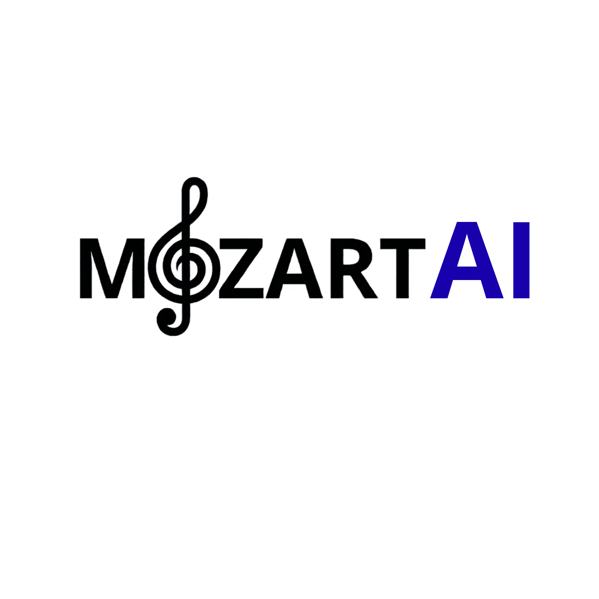

# MozartAI

  

Progetto intelligenza artificiale, consiste in una web app per mobile e per pc dove si possono caricare o fare foto di uno spartito musicale, l'ia si occupera di leggere lo spartito e poi riprodurlo

utilizzo di PyTorch

PR Daniele Callegari 

PR Martino paoloni

PR Lorenzo Bruschi

prova PR
